  

<a href="./README.md">English</a> · <b>Español</b>

## 

AI Automation Engineer en **Ecomfy Lead**, una empresa de distribución de leads B2B en Estados Unidos (remoto). Diseño, despliego y opero **agentes de IA conversacional** y las automatizaciones que los sostienen, combinando LLMs, n8n, JavaScript/Python y CRMs.

<picture>
  <source media="(prefers-color-scheme: dark)" srcset="./assets/neofetch-dark.es.svg">
  <source media="(prefers-color-scheme: light)" srcset="./assets/neofetch-light.es.svg">
  
</picture>

## 

**AI Automation Engineer · Ecomfy Lead** Jun 2026 – Presente · Miami, FL (remoto)

- Diseñé y puse en producción un **agente de IA conversacional para WhatsApp y SMS** que califica leads, responde preguntas frecuentes, agenda llamadas y gestiona el pipeline del CRM con tool calling, atendiendo cada lead nuevo de forma automática.
- Construí el **sistema de n8n que lo sostiene**: seguimientos automáticos, handoff bot → humano con alertas en Slack (el bot se pausa solo cuando entra una persona), transcripción de audios y prospección outbound.
- Desarrollé la **plataforma de outbound B2B** (Next.js + PostgreSQL + n8n) que reemplazó las planillas manuales: carga de empresas, enriquecimiento, campañas por Gmail con tracking de cada envío y un dashboard de múltiples vistas.
- Automaticé el **scraping de empresas en Google Maps** y su **calificación con IA**: Jina lee el sitio de cada empresa y un LLM le asigna puntaje (1-10), rubro y pitch.
- Armé la **prospección de contactos B2B** en español e inglés: búsqueda de perfiles en LinkedIn a escala, enriquecimiento con Hunter, Lusha, Clay y AnyMailFinder, y verificación de emails.
- Construí un **sistema de monitoreo de compradores** que calcula un health score por cuenta, envía alertas a Slack y genera un resumen ejecutivo diario con IA.
- Trabajo con un **flujo de desarrollo agéntico desde la terminal** (Claude Code, OpenCode, Pi): orquesto **sistemas multiagente** y **delego tareas a subagentes especializados** (exploración, implementación, verificación y revisión de código), con memoria persistente entre sesiones.

**Desarrollador de Agentes de IA · Freelance** Ago 2025 – Dic 2025 · Paraguay

- Desarrollé y puse en producción un **agente recepcionista con IA (GPT-4)** para una clínica dental, que atendía un alto volumen de pacientes **24/7 por WhatsApp**, construido como un flujo de **41 nodos en n8n**.
- Implementé una **base de datos de pacientes en PostgreSQL** con memoria persistente para mantener el contexto de cada conversación.
- Integré **Google Calendar** para agendar, reprogramar y cancelar citas, con **recordatorios automáticos** a los pacientes.
- Automaticé el envío de **presupuestos y estados de cuenta en PDF** con el detalle de lo que cada paciente debía abonar.
- Integré **transcripción de audios con Whisper**, **guardrails de IA** y **derivación automática a un operador humano** vía Gmail en casos fuera de alcance.
- Diseñé un **envío de mensajes con ritmo humano y control de frecuencia** (pausas naturales e indicador de escritura) para una entrega confiable en WhatsApp, con testing de flujos y documentación técnica del agente.

## 

## 

| Proyecto | Qué hace | Stack |
|---|---|---|
| [**n8n-whatsapp-ai-agent**](https://github.com/humberto325/n8n-whatsapp-ai-agent) | Plantilla de agente de IA para WhatsApp: transcripción de audios, calificación de leads con tool calling, agenda en calendario y handoff a humano por Slack que pausa al bot. | n8n · OpenAI · WhatsApp Cloud API · Postgres · Slack |
| [**n8n-ai-company-qualifier**](https://github.com/humberto325/n8n-ai-company-qualifier) | Califica empresas en lote según un ICP: Jina Reader lee cada sitio y un LLM devuelve un puntaje validado, rubro y un pitch personalizado. | n8n · Jina AI · OpenAI · Google Sheets |
| [**github-agent-cards**](https://github.com/humberto325/github-agent-cards) | GitHub Action sin dependencias que genera las tarjetas animadas de este perfil, configurable y con soporte de idiomas. | Node.js · GitHub Actions · SVG |

## 

  
  
   
  
   
  
   
  

**IA y LLMs:** sistemas multiagente · delegación a subagentes · desarrollo agéntico en terminal · prompt engineering · tool calling · guardrails · MCP · transcripción de audio (Whisper)

## 

