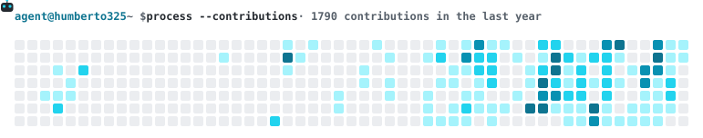

  

<b>English</b> · <a href="./README.es.md">Español</a>

## 

AI Automation Engineer at **Ecomfy Lead**, a B2B lead distribution company in the United States (remote). I design, ship and run **conversational AI agents** and the automations behind them, combining LLMs, n8n, JavaScript/Python and CRMs.

<picture>
  <source media="(prefers-color-scheme: dark)" srcset="./assets/neofetch-dark.svg">
  <source media="(prefers-color-scheme: light)" srcset="./assets/neofetch-light.svg">
  
</picture>

## 

**AI Automation Engineer · Ecomfy Lead** Jun 2026 – Present · Miami, FL (remote)

- Designed and shipped a **conversational AI agent for WhatsApp and SMS** that qualifies leads, answers FAQs, books calls and manages the CRM pipeline through tool calling, handling every new lead automatically.
- Built the **n8n system around it**: automated follow-ups, bot → human handoff with Slack alerts (the bot pauses itself when a person takes over), voice-note transcription and outbound prospecting.
- Built the **B2B outbound platform** (Next.js + PostgreSQL + n8n) that replaced manual spreadsheets: company intake, enrichment, Gmail campaigns with per-email tracking and a multi-view dashboard.
- Automated **Google Maps company scraping** and **AI qualification**: Jina reads each company's website and an LLM assigns a score (1-10), industry and pitch.
- Built **B2B contact prospecting** in Spanish and English: LinkedIn profile search at scale, enrichment with Hunter, Lusha, Clay and AnyMailFinder, plus email verification.
- Built a **buyer monitoring system** that scores account health, sends Slack alerts and writes a daily AI executive summary.
- Work with an **agentic development flow from the terminal** (Claude Code, OpenCode, Pi): I orchestrate **multi-agent systems** and **delegate to specialized subagents** (exploration, implementation, verification and code review), with persistent memory across sessions.

**AI Agent Developer · Freelance** Aug 2025 – Dec 2025 · Paraguay

- Built and shipped an **AI receptionist (GPT-4)** for a dental clinic, handling a high volume of patients **24/7 over WhatsApp**, built as a **41-node n8n flow**.
- Implemented a **PostgreSQL patient database** with persistent memory to keep each conversation's context.
- Integrated **Google Calendar** to book, reschedule and cancel appointments, with **automatic patient reminders**.
- Automated **PDF quotes and account statements** detailing what each patient owed.
- Added **Whisper voice transcription**, **AI guardrails** and **automatic handoff to a human operator** via Gmail for out-of-scope cases.
- Designed **rate-limited, human-paced messaging** (natural delays and typing indicators) for reliable WhatsApp delivery, with flow testing and technical documentation.

## 

## 

| Project | What it does | Stack |
|---|---|---|
| [**n8n-whatsapp-ai-agent**](https://github.com/humberto325/n8n-whatsapp-ai-agent) | WhatsApp AI agent template: voice-note transcription, lead qualification with tool calling, calendar booking and a Slack human handoff that pauses the bot. | n8n · OpenAI · WhatsApp Cloud API · Postgres · Slack |
| [**n8n-ai-company-qualifier**](https://github.com/humberto325/n8n-ai-company-qualifier) | Batch-qualifies companies against an ICP: Jina Reader scrapes each site, an LLM returns a validated score, industry and personalized pitch. | n8n · Jina AI · OpenAI · Google Sheets |
| [**github-agent-cards**](https://github.com/humberto325/github-agent-cards) | Zero-dependency GitHub Action that renders the animated cards on this profile, with config and localization. | Node.js · GitHub Actions · SVG |

## 

  
  
   
  
   
  
   
  

**AI & LLMs:** multi-agent systems · subagent delegation · agentic development in the terminal · prompt engineering · tool calling · guardrails · MCP · audio transcription (Whisper)

## 

